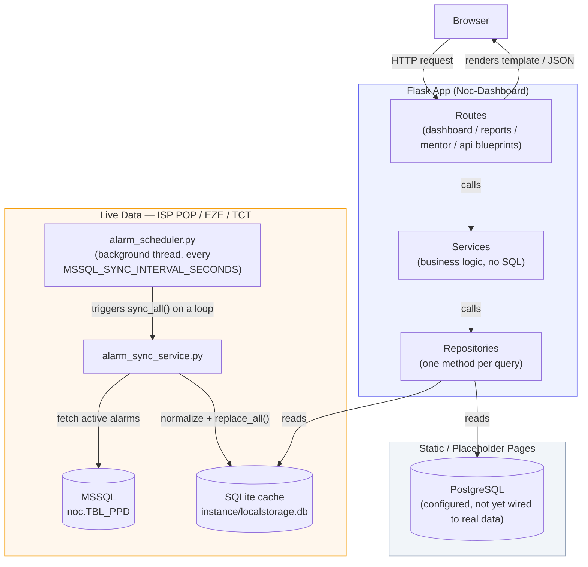
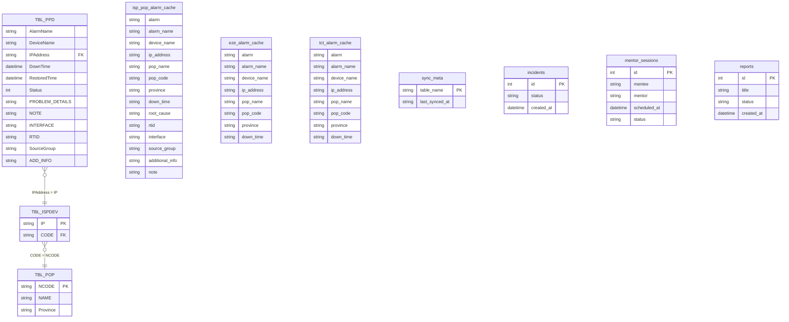

# Noc-Dashboard — Architecture Diagrams

All diagrams below describe the real code in this project (routes, services,
repositories, database layer). Paste any block into
[eraser.io](https://app.eraser.io/) — the `mermaid` blocks render natively
there, and the plain blocks are Eraser's own diagram-as-code syntax.

---

## 1. Overall Request / Data Flow



---

## 2. Entity Relationship Diagram

Built from the real `.sql` files in `app/database/queries/`.



Note: the three groups (MSSQL / SQLite cache / Postgres) are separate
databases with no real foreign keys between them — only the MSSQL group has
actual joins. `eze_alarm_cache`/`tct_alarm_cache` share the identical
14-column schema shown in full on `isp_pop_alarm_cache`.

---

## 3. Cloud/Architecture Overview

```
title Noc-Dashboard Architecture

Browser [icon: monitor]

Flask App [icon: server] {
  Routes [icon: signpost]
  Services [icon: cog]
  Repositories [icon: layers]
}

Background Sync [color: orange] {
  Scheduler [icon: clock]
  Sync Service [icon: refresh-cw]
}

MSSQL [icon: database, color: blue]
SQLite Cache [icon: database]
PostgreSQL [icon: database, color: grey]

Browser > Routes
Routes > Services > Repositories
Repositories > SQLite Cache
Repositories > PostgreSQL
Scheduler > Sync Service > MSSQL
Sync Service > SQLite Cache
```

---

## 4. CSV Export Flow (Drilldown → Download)

```
title CSV Export Flow

Browser [icon: monitor]
Export Button [icon: download]

Flask Route [icon: server] {
  drilldown_download [icon: file-text]
}

Fetch Rows [icon: filter]
Alarm Service [icon: cog]
SQLite Cache [icon: database]

CSV Builder [color: orange] {
  Pick Columns [icon: columns]
  Write Rows [icon: table]
  Sanitize Filename [icon: shield]
}

CSV File [icon: file-text]

Browser > Export Button
Export Button > drilldown_download
drilldown_download > Fetch Rows
Fetch Rows > Alarm Service > SQLite Cache
SQLite Cache > Fetch Rows
Fetch Rows > Pick Columns > Write Rows > Sanitize Filename
Sanitize Filename > CSV File
CSV File > Browser
```

Key points:
- `Fetch Rows` (`_fetch_rows()` in `dashboard.py`) filters by alarm type and
  `down_time` date range in Python — never touches MSSQL, only the cache.
- `Sanitize Filename` strips the `scope`/`type` query params down to
  `[A-Za-z0-9_-]` before they go into the `Content-Disposition` header, so a
  crafted query string can't inject extra header content.

---

## 5. Background MSSQL Sync Flow (with the reliability fix applied)

```
title Background MSSQL Sync Flow

App Startup [icon: play]

Scheduler Thread [color: orange] {
  start [icon: rocket]
  Loop Forever [icon: refresh-cw]
  Sleep Interval Seconds [icon: clock]
}

Sync Service [icon: cog] {
  sync_all [icon: list]
  sync_one [icon: repeat]
}

MSSQL [icon: database, color: blue]
SQLite Cache [icon: database]

Fetch Step [color: red] {
  Fetch Failed [icon: alert-triangle]
  Log Fetch Error [icon: file-text]
}

Write Step [color: red] {
  Write Failed [icon: alert-triangle]
  Log Write Error [icon: file-text]
}

Success [color: green] {
  Normalize Rows [icon: shuffle]
  Replace Cache Table [icon: database]
  Log Success [icon: check]
}

App Startup > start
start > Loop Forever
Loop Forever > sync_all
sync_all > sync_one
sync_one > MSSQL

MSSQL > Fetch Failed
Fetch Failed > Log Fetch Error
Log Fetch Error > Sleep Interval Seconds

MSSQL > Normalize Rows
Normalize Rows > Replace Cache Table

Replace Cache Table > Write Failed
Write Failed > Log Write Error
Log Write Error > Sleep Interval Seconds

Replace Cache Table > Log Success
Log Success > SQLite Cache
Log Success > Sleep Interval Seconds

Sleep Interval Seconds > Loop Forever
```

Key points:
- Both the fetch step and the cache-write step are wrapped in their own
  try/except (`app/services/alarm_sync_service.py::_sync_one()`) — a
  failure in either one logs an error and safely continues the loop,
  instead of crashing the background thread forever.
- The sleep is unconditional — success or failure, the loop always waits
  `MSSQL_SYNC_INTERVAL_SECONDS` (10s by default) before the next cycle, so
  it can never spin in a tight error loop hammering MSSQL.

---

## 6. MSSQL Request Diagram (one query, in detail)

```
title MSSQL Request Diagram

Alarm Repository [icon: layers] {
  Fetch ISP POP Active [icon: file-text]
}

Run MSSQL Query [icon: server]
Load Named Query [color: blue] {
  Check Cache [icon: zap]
  Read alarms.sql [icon: file]
  Split On Query Markers [icon: scissors]
}

Connect [color: orange] {
  Try Connect [icon: plug]
  Retry Up To 3x [icon: refresh-cw]
  Give Up [icon: x-circle]
}

MSSQL Server [icon: database, color: blue]

Run Query [color: green] {
  Open Cursor [icon: terminal]
  Execute SQL [icon: play]
  Fetch All Rows [icon: list]
  Close Connection [icon: log-out]
}

Rows Returned [icon: check-circle]

Fetch ISP POP Active > Run MSSQL Query
Run MSSQL Query > Check Cache
Check Cache > Read alarms.sql
Read alarms.sql > Split On Query Markers
Check Cache > Try Connect

Try Connect > MSSQL Server
MSSQL Server > Retry Up To 3x
Retry Up To 3x > Try Connect
Retry Up To 3x > Give Up

MSSQL Server > Open Cursor
Open Cursor > Execute SQL > Fetch All Rows > Close Connection
Close Connection > Rows Returned
Rows Returned > Fetch ISP POP Active
```

Key points:
- The named `.sql` query is parsed once and cached (`@lru_cache` in
  `app/database/sql_loader.py`) — every call after the first skips
  re-reading the file.
- `_connect()` retries up to 3 times (1s/2s/3s backoff) before giving up —
  this is what the sync flow's "Fetch Failed" branch catches.
- The connection is always closed in a `finally` block, whether the query
  succeeded or not — no connection leak on error.
