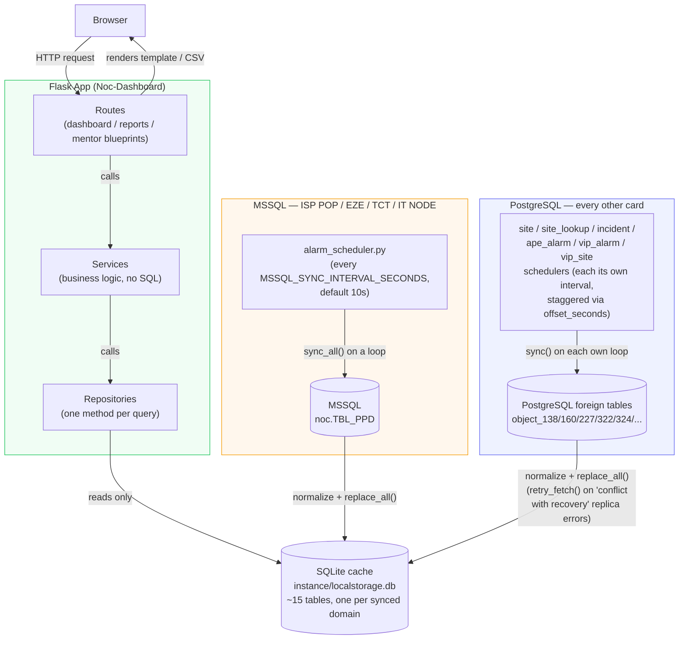

# Noc-Dashboard — Architecture Diagrams

All diagrams below describe the real code in this project (routes, services,
repositories, database layer). Paste any block into
[eraser.io](https://app.eraser.io/) — the `mermaid` blocks render natively
there, and the plain blocks are Eraser's own diagram-as-code syntax.

---

## 1. Overall Request / Data Flow

Every card is live — MSSQL backs ISP POP/EZE/TCT/IT NODE, PostgreSQL backs
everything else (RAN, Incident/INC-WO, VVIP, Mentor, Alarm Site
Down/Main Failure/DG On). Neither is ever queried by a page directly —
both flow into the same local SQLite cache through their own set of
background schedulers, and pages only ever read that cache.



---

## 2. Entity Relationship Diagram

Built from the real `.sql` files in `app/database/queries/`. Only the
MSSQL group has real foreign keys — the Postgres group and the SQLite
cache group are separate databases with no enforced FKs between them;
relationships there are join conditions inside the `.sql` queries
(source system) or plain Python dict lookups by site_code (cache reads).

```mermaid
erDiagram
    %% MSSQL — live alarm source (noc schema), read by app/database/mssql.py
    %% Backs ISP POP / EZE / TCT / IT NODE only.
    TBL_PPD {
        string AlarmName
        string DeviceName
        string IPAddress FK
        datetime DownTime
        datetime RestoredTime
        int Status
        string PROBLEM_DETAILS
        string NOTE
        string INTERFACE
        string RTID
        string SourceGroup
        string ADD_INFO
    }
    TBL_ISPDEV {
        string IP PK
        string CODE FK
    }
    TBL_POP {
        string NCODE PK
        string NAME
        string Province
    }
    TBL_PPD }o--|| TBL_ISPDEV : "IPAddress = IP"
    TBL_ISPDEV }o--|| TBL_POP : "CODE = NCODE"

    %% PostgreSQL — foreign tables, backs every other card. Generically
    %% named object_N on the wire; see docs/postgres-object-tables.md for
    %% the object_1 -> real-name lookup.
    object_138_alarm {
        string event_name
        string site_code
        string additional_info
        string nms
        datetime occurred_at
    }
    object_160_site {
        int id PK
        string standard_code
        string status "excludes off_air everywhere it's read"
        string site_grade
        string hub_site
        int province FK
        int district FK
        int commune FK
        int physical_location FK
    }
    object_162_province { int id PK }
    object_164_district { int id PK }
    object_166_commune { int id PK }
    object_308_physical_location { int id PK }
    object_310_team {
        int id PK
        string name
    }
    object_227_ne {
        string site_name FK
        string technology
        string nms_name
    }
    object_322_incident {
        string incident_id PK
        string status
        string site_text "free text, parsed to match Site.standard_code"
        string incident_category
        bool overdue
    }
    object_324_inc_wo {
        string wo_id PK
        int parent_incident FK
        int site FK
        int responsible_team FK
        string status
        string support_level
        datetime created_at
    }
    object_138_alarm }o--o| object_160_site : "site_code = standard_code (Python join)"
    object_227_ne }o--|| object_160_site : "site_name = id"
    object_322_incident }o--o{ object_160_site : "site_text parsed = standard_code"
    object_324_inc_wo }o--|| object_322_incident : "parent_incident = id"
    object_324_inc_wo }o--o| object_310_team : "responsible_team = id"
    object_160_site }o--|| object_162_province : "province = id"
    object_160_site }o--|| object_164_district : "district = id"
    object_160_site }o--|| object_166_commune : "commune = id"
    object_160_site }o--|| object_308_physical_location : "physical_location = id"

    %% SQLite cache — instance/localstorage.db, one table per synced
    %% domain (app/database/cache.py). Pages read only from here.
    isp_pop_alarm_cache {
        string alarm
        string alarm_name
        string pop_name
        string pop_code
        string down_time
    }
    eze_alarm_cache { string alarm }
    tct_alarm_cache { string alarm }
    it_node_alarm_cache { string alarm }
    ape_alarm { string event_name "the broader Postgres alarm feed" }
    site_cache { string standard_code "off_air already excluded" }
    site_technology_cache { string site_code "off_air already excluded" }
    incident_by_status { string incident_id }
    incident_site_down { string incident_id }
    inc_wo_by_status { string wo_id }
    inc_wo_site_down { string wo_id }
    inc_wo_resolved { string wo_id }
    vip_alarm { string site_code }
    vip_site_cache { string site_code }
    vip_incident_status { string incident_id }
    ne_nms_lookup_cache { string site_code }
    sync_meta {
        string table_name PK
        string last_synced_at
    }
```



---

## 3. Cloud/Architecture Overview

```
title Noc-Dashboard Architecture

Browser [icon: monitor]

Flask App [icon: server] {
  Routes [icon: signpost]
  Services [icon: cog]
  Repositories [icon: layers]
}

MSSQL Sync [color: orange] {
  Alarm Scheduler [icon: clock]
  Alarm Sync Service [icon: refresh-cw]
}

Postgres Sync [color: indigo] {
  Site/Incident/Ape-Alarm/VIP Schedulers [icon: clock]
  Sync Services [icon: refresh-cw]
}

MSSQL [icon: database, color: blue]
SQLite Cache [icon: database]
PostgreSQL [icon: database, color: grey]

Teams Webhook Alerts [icon: send]
Telegram Site Down Alert [icon: send]
Telegram INC-WO Site Down Alert [icon: send]
Telegram INC-WO Category Power Alert [icon: send]
Telegram INC-WO General Alert [icon: send]

Browser > Routes
Routes > Services > Repositories
Repositories > SQLite Cache

Alarm Scheduler > Alarm Sync Service > MSSQL
Alarm Sync Service > SQLite Cache

Site/Incident/Ape-Alarm/VIP Schedulers > Sync Services > PostgreSQL
Sync Services > SQLite Cache

SQLite Cache > Teams Webhook Alerts
SQLite Cache > Telegram Site Down Alert
SQLite Cache > Telegram INC-WO Site Down Alert
SQLite Cache > Telegram INC-WO Category Power Alert
SQLite Cache > Telegram INC-WO General Alert
```

Note: repositories never query MSSQL/PostgreSQL directly on a page
request — only the sync services do, on their own background schedules.
`Teams Webhook Alerts` and the four Telegram alerts are independent
readers of the same cache (see `webhook/README.md` and
`app/services/telegram/telegram_alert.py`/`telegram_inc_wo_alert.py`/
`telegram_inc_wo_power_alert.py`/`telegram_inc_wo_general_alert.py`) —
separate bots/chats/schedules, not part of the request/response path.

---

## 4. CSV Export Flow (Drilldown → Download)

```
title CSV Export Flow

Browser [icon: monitor]
Export Button [icon: download]

Flask Route [icon: server] {
  drilldown_download [icon: file-text]
}

Fetch Rows [icon: filter]
Alarm Service [icon: cog]
SQLite Cache [icon: database]

CSV Builder [color: orange] {
  Pick Columns [icon: columns]
  Write Rows [icon: table]
  Sanitize Filename [icon: shield]
}

CSV File [icon: file-text]

Browser > Export Button
Export Button > drilldown_download
drilldown_download > Fetch Rows
Fetch Rows > Alarm Service > SQLite Cache
SQLite Cache > Fetch Rows
Fetch Rows > Pick Columns > Write Rows > Sanitize Filename
Sanitize Filename > CSV File
CSV File > Browser
```

Key points:
- `Fetch Rows` (`_fetch_rows()` in `dashboard.py`) filters by alarm type and
  `down_time` date range in Python — never touches MSSQL, only the cache.
- `Sanitize Filename` strips the `scope`/`type` query params down to
  `[A-Za-z0-9_-]` before they go into the `Content-Disposition` header, so a
  crafted query string can't inject extra header content.

---

## 5. Background MSSQL Sync Flow (with the reliability fix applied)

```
title Background MSSQL Sync Flow

App Startup [icon: play]

Scheduler Thread [color: orange] {
  start [icon: rocket]
  Loop Forever [icon: refresh-cw]
  Sleep Interval Seconds [icon: clock]
}

Sync Service [icon: cog] {
  sync_all [icon: list]
  sync_one [icon: repeat]
}

MSSQL [icon: database, color: blue]
SQLite Cache [icon: database]

Fetch Step [color: red] {
  Fetch Failed [icon: alert-triangle]
  Log Fetch Error [icon: file-text]
}

Write Step [color: red] {
  Write Failed [icon: alert-triangle]
  Log Write Error [icon: file-text]
}

Success [color: green] {
  Normalize Rows [icon: shuffle]
  Replace Cache Table [icon: database]
  Log Success [icon: check]
}

App Startup > start
start > Loop Forever
Loop Forever > sync_all
sync_all > sync_one
sync_one > MSSQL

MSSQL > Fetch Failed
Fetch Failed > Log Fetch Error
Log Fetch Error > Sleep Interval Seconds

MSSQL > Normalize Rows
Normalize Rows > Replace Cache Table

Replace Cache Table > Write Failed
Write Failed > Log Write Error
Log Write Error > Sleep Interval Seconds

Replace Cache Table > Log Success
Log Success > SQLite Cache
Log Success > Sleep Interval Seconds

Sleep Interval Seconds > Loop Forever
```

Key points:
- Both the fetch step and the cache-write step are wrapped in their own
  try/except (`app/services/alarm/alarm_sync_service.py::_sync_one()`) — a
  failure in either one logs an error and safely continues the loop,
  instead of crashing the background thread forever.
- The sleep is unconditional — success or failure, the loop always waits
  `MSSQL_SYNC_INTERVAL_SECONDS` (10s by default) before the next cycle, so
  it can never spin in a tight error loop hammering MSSQL.
- Every scheduler's sleep is clock-aligned with its own `offset_seconds`
  (`app/services/scheduler_utils.py::seconds_until_next_aligned_time()`),
  not just a plain fixed-length sleep — so the ~9 background jobs don't
  all land on the same instant and spike CPU/DB load together.

**Postgres sync services follow this same shape**, with one addition: the
fetch step is wrapped in `app/services/postgres_sync_utils.py::retry_fetch()`,
which retries on Postgres's "conflict with recovery" error — a hot-standby
replica occasionally killing a read mid-query when the primary's WAL
replay needs that data — instead of treating it as a hard failure.

---

## 6. MSSQL Request Diagram (one query, in detail)

```
title MSSQL Request Diagram

Alarm Repository [icon: layers] {
  Fetch ISP POP Active [icon: file-text]
}

Run MSSQL Query [icon: server]
Load Named Query [color: blue] {
  Check Cache [icon: zap]
  Read alarms.sql [icon: file]
  Split On Query Markers [icon: scissors]
}

Connect [color: orange] {
  Try Connect [icon: plug]
  Retry Up To 3x [icon: refresh-cw]
  Give Up [icon: x-circle]
}

MSSQL Server [icon: database, color: blue]

Run Query [color: green] {
  Open Cursor [icon: terminal]
  Execute SQL [icon: play]
  Fetch All Rows [icon: list]
  Close Connection [icon: log-out]
}

Rows Returned [icon: check-circle]

Fetch ISP POP Active > Run MSSQL Query
Run MSSQL Query > Check Cache
Check Cache > Read alarms.sql
Read alarms.sql > Split On Query Markers
Check Cache > Try Connect

Try Connect > MSSQL Server
MSSQL Server > Retry Up To 3x
Retry Up To 3x > Try Connect
Retry Up To 3x > Give Up

MSSQL Server > Open Cursor
Open Cursor > Execute SQL > Fetch All Rows > Close Connection
Close Connection > Rows Returned
Rows Returned > Fetch ISP POP Active
```

Key points:
- The named `.sql` query is parsed once and cached (`@lru_cache` in
  `app/database/sql_loader.py`) — every call after the first skips
  re-reading the file.
- `_connect()` retries up to 3 times (1s/2s/3s backoff) before giving up —
  this is what the sync flow's "Fetch Failed" branch catches.
- The connection is always closed in a `finally` block, whether the query
  succeeded or not — no connection leak on error.
